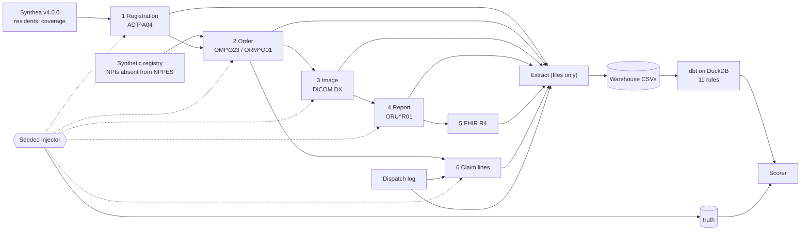

# imaging-flow-audit

A synthetic imaging data flow for a small portable x-ray provider, with known
errors planted at set rates and SQL audit rules that try to catch them. Because
the planted errors are known, the repository reports **recall per error type**:
of the errors planted, how many each rule caught.

The question it answers: when the record of an exam moves from registration to
order to image to report to FHIR resource to claim line, which errors can an
independent review of the data catch, and which pass through quietly?

**Everything here is synthetic.** No patient data, no real images, no real
company and no real person's identifiers. Every report body reads
`SYNTHETIC - NOT A READ`. No model reads any image. The numbers below measure
the rules on synthetic data with planted errors; they are not results from any
client.

## The flow



`docs/flow.md` has the full diagram and the keys that join the hops.

## Recall

<!-- RECALL TABLE -->

Measured on seed 20261101, 24 months (2024-10-01 to 2026-10-31):
10,108 performed exams, 1,128 planted errors, 3,720 cascade records.
**These numbers measure the rules on synthetic data with known planted errors. They are not results from any client.**

| rule | planted | caught | recall | 95% interval | hold-out planted | hold-out caught | cascade flags | cross-flags on other plants | unexplained flags |
|---|---:|---:|---:|---|---:|---:|---:|---:|---:|
| E01 | 114 | 114 | 1.00 | 0.97 to 1.00 | 38 | 38 | 0 | 1 | 0 |
| E02 | 30 | 30 | 1.00 | 0.89 to 1.00 | 9 | 0 | 0 | 14 | 0 |
| E03 | 75 | 75 | 1.00 | 0.95 to 1.00 | 24 | 24 | 0 | 0 | 0 |
| E04 | 60 | 59 | 0.98 | 0.91 to 1.00 | 20 | 20 | 0 | 0 | 0 |
| E05 | 45 | 45 | 1.00 | 0.92 to 1.00 | 15 | 15 | 1133 | 25 | 0 |
| E06 | 107 | 103 | 0.96 | 0.91 to 0.99 | 36 | 36 | 669 | 51 | 0 |
| E07 | 75 | 75 | 1.00 | 0.95 to 1.00 | 25 | 24 | 198 | 0 | 0 |
| E08 | 114 | 114 | 1.00 | 0.97 to 1.00 | 38 | 38 | 0 | 0 | 0 |
| E09 | 76 | 76 | 1.00 | 0.95 to 1.00 | 25 | 25 | 0 | 0 | 0 |
| E11 | 68 | 67 | 0.99 | 0.92 to 1.00 | 34 | 33 | 36 | 2 | 0 |
| E12 | 75 | 75 | 1.00 | 0.95 to 1.00 | 25 | 25 | 0 | 0 | 0 |

The planted column counts core variants only, 839 in all; with the 289 hold-out plants, the total is 1,128.

Recall is caught ÷ planted over the core variants of each rule, with a 95% Wilson interval. Hold-out variants
were written after the rules were frozen and are scored apart. A **cascade flag** is on a record the plant was
expected to reach without being the planted record (the patient's other claim lines after a coverage or member-ID
change, the other lines of a claim sent to the wrong payer, the exam that gained an image); a **cross-flag** is on a
record planted with a different error; an **unexplained flag** is a false positive or a mechanism nobody has
written down. Unexplained flags in this run: **0**. The clean run, with nothing planted, raised
**0** flags (`reports/clean-baseline.md`).

- **E02 `laterality_tag_only_wrong`** (hold-out): 0 of 9 caught. The rule does not see this way of making the error; that is what the hold-out is for, and it stays in the table rather than being fixed into the rule after the fact.
- **E07 `secondary_billed_as_primary`** (hold-out): 24 of 25 caught. The rule does not see this way of making the error; that is what the hold-out is for, and it stays in the table rather than being fixed into the rule after the fact.
- **E11 `three_views_billed_two_images`** (hold-out): 33 of 34 caught. The rule does not see this way of making the error; that is what the hold-out is for, and it stays in the table rather than being fixed into the rule after the fact.

Per-variant numbers: `reports/recall.md`. How each error is planted and what it costs: `docs/error-catalog.md`.

<!-- /RECALL TABLE -->

## What is in the box

| area | where | note |
|---|---|---|
| residents and coverage | `data/synthea-sample/` | 2,000 living residents from Synthea v4.0.0 with generic payers and fictitious facilities; `MANIFEST.json` carries the seed and hashes |
| the generators, hop by hop | `src/flow/` | `registration.py`, `orders.py`, `modality.py`, `reports.py`, `fhir_map.py`, `claims.py`; `hl7_messages.py` writes every message in its v2.8 form and the older form real systems still send |
| HL7 encoding and validation | `src/flow/er7.py`, `src/flow/validate_hl7.py`, `tools/hl7-validate/` | fields placed by the standard's numbers; every file validated with HAPI HL7v2 2.6.0; hl7apy strict as a second opinion on v2.5.1 |
| the injector | `src/flow/inject_errors.py`, `config/error_rates.yaml` | eleven error types, two or three variants each plus a hold-out written after the rules were frozen |
| the review | `src/flow/extract.py`, `dbt/`, `src/flow/audit.py` | the extract reads files, never memory; dbt stages, builds the exam spine and runs one singular test per rule with stored failures; the scorer is the only reader of `truth/` |
| the rule book | `docs/error-catalog.md` | each rule, its variants, its cross-flags, and why the error costs money |
| HL7 study notes | `docs/hl7-field-notes.md`, `data/samples/` | every segment and field the flow uses, with data type and optionality from the standard's tables, and six sample messages |
| data dictionary | `docs/data-dictionary.md` | every table and key |

## Run it

Python 3.12 and a JDK 17 or later (for HAPI, and for Synthea if you regenerate the sample). No containers.

```
py -3.12 -m venv .venv && .venv/Scripts/pip install -r requirements.txt   # Windows
bash tools/hl7-validate/fetch_hapi.sh      # pinned HAPI jars, SHA-256 checked, compiled
.venv/Scripts/pytest -q                    # unit and integration tests
.venv/Scripts/python run_all.py --months 3 # clean + injected runs, dbt, scorer -> reports/
```

`run_all.py --months 24` is the run the reports here come from. To regenerate
the Synthea sample: `bash synthea/fetch_jar.sh`, `synthea/run_synthea.sh 2000 20261101`,
then `python synthea/distill.py --population 2000 --seed 20261101`.

## Controls

Every negative result has a positive control beside it, because a check that
cannot see reports absence exactly like a check that looked and found nothing:

- the clean run is the negative control for every rule (`reports/clean-baseline.md`), and on the injected run every rule must fire;
- hold-out variants are scored apart from the variants the rules were written against;
- the vocabulary controls assert every configured code occurs and every generated code is configured;
- the HL7 validators are each fed a deliberately broken message that must fail (`tests/test_validate_hl7.py`);
- the synthetic NPIs are checked against the NPI Registry with a known-assigned control (`scripts/check_nppes.py`); the first run of that check found two generated numbers that were real, assigned NPIs, which is why every synthetic NPI now takes the 2 prefix;
- the publish scan (`tests/test_publish_scan.py`) plants one line of each thing it forbids and must flag it, and proves it catches a REAL NPI by reading one from the registry at test time (the NPPES data file when `NPPES_FILE` names one, otherwise the registry API) — a real NPI is never committed here;
- the same seed gives byte-identical artifacts (`MANIFEST.json`), and the Synthea sample scan for default insurer names carries a planted sentinel.

## Limits

- Milestone 1: files on a laptop, no containers. No PACS, interface engine or FHIR server is running; those are the next steps, and the audit is built to read from them instead of from files.
- The clinical content is a fixed template. Nothing here reads an image or makes a finding.
- Part B billing during a Part A nursing-facility stay is carried in the data, but no rule reads it until the code-level rule is confirmed against CMS's consolidated billing update.
- Coverage comes from Synthea's yearly periods, with Medicare split into fee-for-service and Advantage per resident by the registration step.
- The charges are a flat synthetic schedule, not a fee schedule.

## Licence

MIT, Ehi Eromosele. HAPI HL7v2 (MPL 1.1 / GPL dual) and Synthea (Apache-2.0) are downloaded at build time and never vendored.
