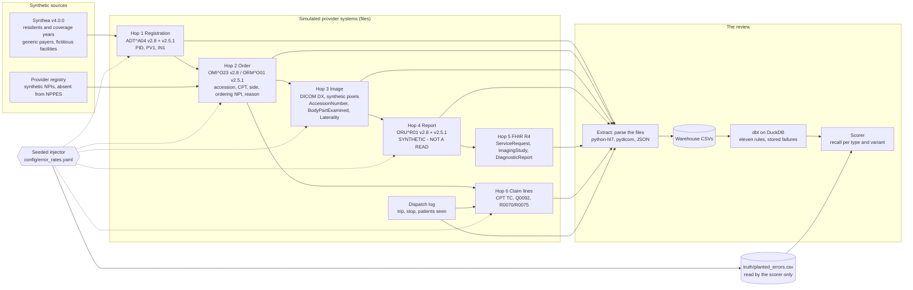

# The flow

How one portable x-ray exam moves through a small provider's systems, and
where this repository plants and catches errors. Everything is synthetic.

## The keys that hold it together

| key | where it is written | where it must match |
|---|---|---|
| MRN | PID-3 on every message; DICOM PatientID; claim `mrn` | everywhere |
| accession | IPC-1 (v2.8) or OBR-18 (v2.5.1) on the order; DICOM AccessionNumber; FHIR ImagingStudy identifier ACSN; claim technical-component line | order, image, FHIR, claim (E01, E04) |
| placer order number | ORC-2 on the order and on the report | order to report (E09) |
| ordering NPI | PRT-5 (OP) or ORC-12/OBR-16; claim box 17b | order to claim (E08) |
| payer and member ID | IN1-2, IN1-12/13, IN1-22, IN1-36; claim `payer_id`, `member_id`, `date_of_service` | registration to claim (E05, E06, E07) |
| trip | dispatch log; transport line | stop to claim (E12) |

## What each hop writes

1. **Registration** (`src/flow/registration.py`, `hl7_messages.adt_a04`): residents from the Synthea sample get an MRN, a facility and coverage rows with generic payers and scheme-valid member IDs. One ADT^A04 per resident, in both forms.
2. **Order** (`orders.py`, `hl7_messages.order_v28` / `order_v251`): trips on weekdays, one to six exams per stop, procedures drawn from the vocabulary with a side where the body part is sided, the attending practitioner as orderer, and a statement of the patient's condition. One order message per exam, in both forms. About one order in a hundred is cancelled.
3. **Image** (`modality.py`): one DX study per performed exam, one series, one instance per view; headers from the order and the patient; 64 x 64 synthetic pixels with SYNTHETIC drawn in.
4. **Report** (`reports.py`, `hl7_messages.report_v28` / `report_v251`): a final report inside the SLA with the fixed template body, read by a registry radiologist.
5. **FHIR** (`fhir_map.py`): ServiceRequest, ImagingStudy and DiagnosticReport as R4 JSON, validated against the R4B models in tests.
6. **Claim lines** (`claims.py`): per exam the technical component and Q0092; per trip and patient one transport line, R0070 or R0075 with the count modifier.

## The review

`src/flow/extract.py` reads the files, never the generator's memory, into `warehouse/*.csv`. `dbt/` stages them in DuckDB, builds the exam spine and the coverage-on-date-of-service table, and runs one singular test per error type with `store_failures`. `src/flow/audit.py` runs dbt, checks the vocabulary controls, and scores recall against the truth file. `docs/error-catalog.md` is the rule book; `reports/recall.md` is the result.
